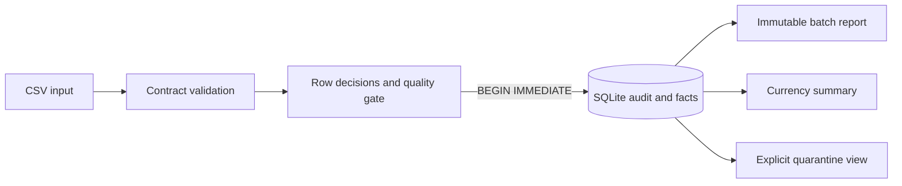

# BatchGuard

BatchGuard is a local Python and SQLite pipeline for contract-checked CSV sales ingestion. It validates each batch, records row-level decisions, applies a configurable quality gate, and atomically publishes accepted facts with audit history. It uses only Python's standard library at runtime.

[CI results](https://github.com/Mzulhaq/batchguard/actions/workflows/ci.yml) · [Verification details](docs/validation.md) · [Interview guide and exercise](docs/interview-guide.md)

## Pipeline



The `sales-v1` contract requires the seven columns `order_id,ordered_at,customer_id,sku,quantity,unit_price,currency` in any order. It accepts UTF-8 (including a BOM), ignores blank records, and allows at most 5 MiB and 50,000 records. Timestamps use `YYYY-MM-DDTHH:MM:SS[.ffffff]` followed by `Z` or an offset such as `-05:00`; fractional seconds may have one through six digits. Higher precision is rejected instead of silently truncated. Identifiers use 1–64 ASCII letters, digits, dots, underscores, or dashes. Quantity is 1–10,000. Prices are nonnegative decimal strings up to 1,000,000.00 with at most two decimal places. Currencies are USD, EUR, and GBP, each treated as a two-decimal currency. Prices and totals are stored as integer minor units; currency totals are never combined.

The default rejected-row threshold is exactly 20%. A batch at the threshold passes. The fraction counts rejected records, not individual validation issues. Fatal parser errors, invalid headers, and validator resource-limit violations block the entire batch. CSV follows Python's `csv` Excel dialect with `strict=True`, not an additional RFC validator: unterminated quoted fields are fatal, while quotes embedded in unquoted fields are literal characters subject to row validation. Repeated order IDs within one file quarantine every occurrence. Across batches, an identical normalized record for the same source and order ID is a duplicate; changed content is quarantined as a conflict and never overwrites the published fact.

## Setup

Requires Python 3.11 or later. Create and activate a virtual environment, install the pinned development tools, then install BatchGuard:

```powershell
python -m venv .venv
.\.venv\Scripts\Activate.ps1
python -m pip install -r requirements.lock
python -m pip install --no-deps -e .
```

On Linux or macOS, use `source .venv/bin/activate` after creating the environment. There are no third-party runtime dependencies; the lock file is for development and verification tooling.

Run the synthetic end-to-end demonstration:

```bash
python scripts/demo.py
```

The demo runs three synthetic CSV batches: an initial five-row batch with four accepted and one rejected row, an exact replay, a blocked two-row batch with one valid row withheld and one rejected, and a corrected three-row batch. It asserts a final summary of seven facts: USD 3,800, EUR 280, and GBP 999, all in minor units. It also checks that replay creates no additional batch and that a blocked batch leaves totals unchanged. It uses a temporary database and removes it on exit. See [validation evidence](docs/validation.md) for actual checks and their limits.

## CLI

The default database is `batchguard.db` in the current directory. Set a different path with the global `--db` option, which goes before the command:

```bash
batchguard --db warehouse.db ingest sales.csv --source storefront
batchguard --db warehouse.db report BATCH_ID
batchguard --db warehouse.db quarantine BATCH_ID
batchguard --db warehouse.db summary
```

`ingest` accepts `--max-reject-fraction` from 0 through 1; the default is `0.20`. It prints a JSON report. `report` shows immutable row decisions and stable error codes without raw row values. `quarantine` is an explicit operator action that returns rejected raw row values as JSON. The local SQLite audit database stores raw values for every row, including accepted rows; protect and manage that file as sensitive data.

Exit codes are `0` for a published batch or successful query, `1` for an operational error, and `2` for a quality-blocked ingest. Standard argparse usage errors also exit `2`; they print usage information rather than the JSON operational error format.

CLI preflight is an exception to audited rejection: unreadable files, invalid policies, and files exceeding 5 MiB exit `1` before creating a database or report. Input accepted by preflight reaches the validator; parser and row-limit failures there produce an audited blocked batch with exit `2`.

Publication, the batch report, row decisions, and newly accepted facts commit together in one SQLite transaction. An exact replay, determined from the source, original file hash, and complete contract fingerprint, returns the immutable report without publishing again. Each fact keeps batch and logical CSV record lineage; the header is record 1.

## Development and container

```bash
pytest --cov=batchguard --cov-report=term-missing
ruff check .
ruff format --check .
python -m build
docker build -t batchguard .
docker run --rm batchguard
```

The container runs the synthetic demo as a non-root user. The CLI itself runs locally and does not require a server or credentials.

## Scope

BatchGuard is a local, single-writer-oriented CLI backed by SQLite, with publication decisions serialized through SQLite's write transaction. It has no authentication, encryption, schema migrations, distributed execution, retention policy, or production service-level objective. The audit database contains raw input values. Review access, backup, and deletion policies before using sensitive data. The contract does not infer schemas or perform currency conversion; its three supported currencies are treated as having two decimal places.

Python's CSV field-size setting is process-global. BatchGuard serializes its own parsing while temporarily setting that limit to 5 MiB and restores it afterward. Unrelated code parsing CSV concurrently in the same process does not share that lock; use the CLI in a separate process for that integration scenario.

For a guided discussion and a short extension exercise, see the [interview guide](docs/interview-guide.md). [Career fit](docs/career-fit.md) relates the project's demonstrated skills to an example data-engineering posting without making claims about individual eligibility or fit.

## AI assistance

This project was designed, implemented, tested, and reviewed with AI coding assistance. The interview guide includes an exercise and draft resume bullets to adapt only after understanding the implementation and accurately identifying your own contribution.
